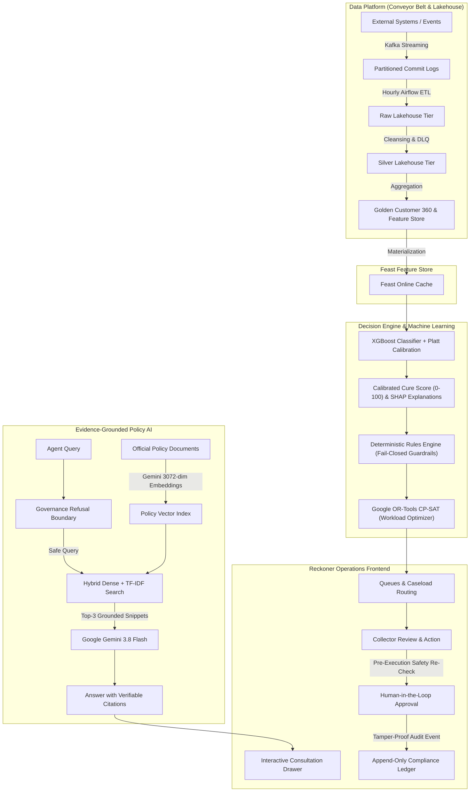

# System Reference Guide & Architecture Walkthrough
## Reckoner / Agentic Collections Copilot Platform

> **Quick Access**: The complete, detailed architectural guide is available at [docs/HOW_IT_WORKS.md](file:///c:/Users/vinay/OneDrive/Desktop/Zoltraak/docs/HOW_IT_WORKS.md).

---

## 1. Executive Summary (In Plain English)

### What is this platform?
Think of this platform as an **intelligent air traffic control tower for a bank's debt recovery and customer support teams**.

When individuals fall behind on loan, credit card, or mortgage payments, financial institutions often struggle with fragmented computer systems. One department might not know that a customer requested a hardship review yesterday, while another automated dialer calls them repeatedly. This causes customer distress, regulatory violations, and financial waste.

**Reckoner** solves this by:
1. **Flagship Customer 360 & Raw Ingest Separation Pipeline**: Connecting records across credit cards, loans, and mortgages into verified Golden Customer profiles. Ingesting raw unstructured notes or 16-row cross-portfolio CSV batches, automatically disambiguating borrower entities, routing to domain ledgers (Payments, PTPs, Whisper Signals, Regulatory Holds), and quarantining unrelated records to the Dead-Letter Queue (DLQ).
2. **Preventing Regulatory Mistakes (Fail-Closed Rules)**: Strictly enforcing Canadian FCAC rules (e.g., maximum 3 contact attempts per 7 days, zero calls to customers with verified Do-Not-Contact requests).
3. **Forecasting Repayment Likelihood**: Using machine learning (XGBoost) to predict who can recover with temporary relief versus who needs immediate restructuring.
4. **Providing an AI Assistant (RAG Copilot)**: Giving collection officers an assistant powered by Google Gemini that only answers questions using official bank policy documents, citing the exact page and paragraph for every recommendation.
5. **Human Control**: The AI **never** takes money or changes customer statuses on its own. Every consequential action requires a verified bank employee to review, approve, and execute it.

---

## 2. Visual System Architecture



---

## 3. The 8-Step Actual Workflow

1. **Step 1: Real-Time Event Streaming (Kafka Broker)**: Emits and validates banking transactions and promises into partitioned topic commit logs (`data_platform/streaming/`).
2. **Step 2: Lakehouse Batch Refinement (Raw $\rightarrow$ Silver $\rightarrow$ Golden)**: PySpark-style DataFrame transformations cleanse anomalies into a Dead Letter Queue (DLQ) and generate Golden Customer 360 tables.
3. **Step 3: Identity Resolution (Splink Matcher)**: Links customer records across credit cards and mortgages using probabilistic scoring and reversible crosswalks.
4. **Step 4: Machine Learning Scoring (XGBoost + Platt Calibration)**: Computes calibrated 0–100 Honor Scores and local SHAP feature attributions (`models_ml/training_service.py`).
5. **Step 5: Deterministic Business Rule Guardrails**: Fail-closed rules strictly block outreach if a Do-Not-Contact flag, 3-contact statutory cap, or dispute hold is active.
6. **Step 6: Caseload Optimization (Google OR-Tools CP-SAT)**: Solves the exact mathematical integer programming problem to distribute accounts fairly across agents while strictly respecting capacity and specialist accreditation.
7. **Step 7: Collector Consultation (RAG AI Copilot)**: Google Gemini 3.8 Flash grounded in 3072-dimensional dense embeddings answers queries with verifiable policy citations (`copilot/service.py`).
8. **Step 8: Human Approval & Append-Only Audit**: Consequential state changes require human authorization, undergo pre-execution safety re-checks, and write immutable audit entries.

---

## 4. Languages, Frameworks, and Tools Summary

* **Languages**: Python 3.12, JavaScript (ES6+), HTML5, CSS3, SQL.
* **Backend**: Django 6.1, Django REST Framework 3.15.
* **AI & LLM**: Google Gemini 3.8 Flash (`gemini-3.8-flash`), Google Gemini Embeddings (`gemini-embedding-001`, 3072-dim).
* **Machine Learning**: XGBoost (v2.1+/v3.4+), Scikit-Learn (`CalibratedClassifierCV`, `TfidfVectorizer`).
* **Optimization**: Google OR-Tools CP-SAT (`ortools.sat.python.cp_model`).
* **Feature Store**: Feast (`data_platform/feast_store/`).
* **Data Platform**: Kafka Partitioned Streaming, PySpark-style Lakehouse, Apache Airflow DAGs (`airflow/dags/`).
* **Async Workers**: Celery 5.6 + Redis 7.
* **Containers**: Docker Compose (PostgreSQL 16 with pgvector, Kafka, Spark, Redis, Celery).
* **UI/UX**: Reckoner Capital Management aesthetic (`reckoner.com`) with Geist & Geist Mono typography.

---

## 5. Quick Run & Verification

```powershell
cd backend
python manage.py runserver 127.0.0.1:8000
```
Open **`http://127.0.0.1:8000/`** to interact with the Reckoner UI.
