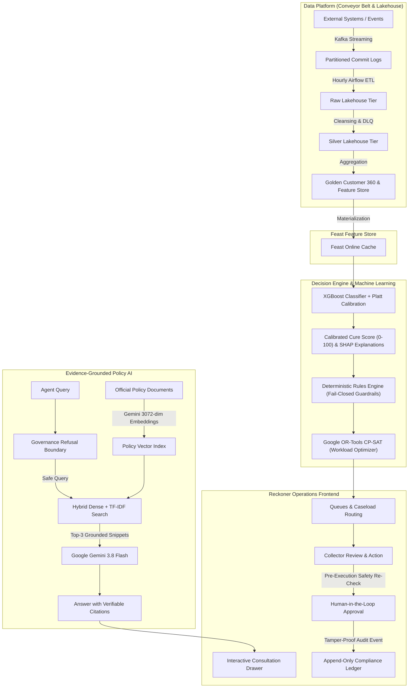

# System Reference Guide & Architecture Walkthrough
## Reckoner / Agentic Collections Copilot Platform

> **Document Purpose**: A comprehensive, plain-language and technical reference explaining how the entire platform operates, the real end-to-end operational workflow, the tools and languages utilized, and how each component ensures regulatory compliance, machine learning accuracy, and human oversight.

---

## 1. Executive Summary (In Plain English)

### What is this platform?
Think of this platform as an **intelligent air traffic control tower for a bank's debt recovery and customer support teams**.

When individuals fall behind on loan, credit card, or mortgage payments, financial institutions often struggle with fragmented computer systems. One department might not know that a customer requested a hardship review yesterday, while another automated dialer calls them repeatedly. This causes customer distress, regulatory violations, and financial waste.

**Reckoner** solves this by:
1. **Unifying Data**: Connecting records across credit cards, personal loans, and mortgages into one verified "Customer 360" view.
2. **Preventing Regulatory Mistakes (Fail-Closed Rules)**: Strictly enforcing Canadian FCAC rules (e.g., maximum 3 contact attempts per 7 days, zero calls to customers with verified Do-Not-Contact requests).
3. **Forecasting Repayment Likelihood**: Using machine learning (XGBoost) to predict who can recover with temporary relief versus who needs immediate restructuring.
4. **Providing an AI Assistant (RAG Copilot)**: Giving collection officers an assistant powered by Google Gemini that only answers questions using official bank policy documents, citing the exact page and paragraph for every recommendation.
5. **Human Control**: The AI **never** takes money or changes customer statuses on its own. Every consequential action requires a verified bank employee to review, approve, and execute it.

---

## 2. Visual System Architecture



---

## 3. The 8-Step Actual Workflow

Here is the exact step-by-step lifecycle of how customer accounts move through the system:

### Step 1: Flagship Feature: Lakehouse Raw Ingestion & Entity Separation Engine
* **What Happens**: Operates as the central clearinghouse for unstructured call notes, teller counter receipts, IVR phone logs, and multi-entity batch CSV streams.
* **The 4-Step Separation Pipeline**:
  1. **Multi-Source Ingest**: Ingests raw batch CSV, JSON payloads, or free-form text without requiring pre-formatting.
  2. **Entity Disambiguation**: Cross-references identifiers (name, phone, email, account reference) against 10 Golden Customers using deterministic keys and Splink probabilistic scoring.
  3. **Domain Router**: Automatically separates mixed multi-entity payloads into their appropriate domain ledgers:
     - `Payment Ledger`: Reconciles payments, deducts arrears balances, and marks open PTPs as `KEPT`.
     - `Promise-to-Pay (PTP) Ledger`: Enrolls formal payment commitments with due dates.
     - `Contact Center Outreach`: Logs channel touches (`phone`, `sms`, `email`, `letter`) and increments FCAC 7-day rolling counters.
     - `Whisper Signal Extraction`: Extracts NLP signals (`dispute_signal`, `hardship_indicator`, `payment_intent`, `dnc_restriction`) from conversation transcripts.
     - `Regulatory Holds`: Automatically trips dispute investigations, hardship reviews, or DNC flags if severe signals are detected.
  4. **Golden Ledger & DLQ Quarantine**:
     - Confident Matches ($\ge 0.85$): Committed directly into Golden Customer ledgers.
     - Ambiguous Matches ($0.60 \le \text{confidence} < 0.85$): Escalated to the Data Steward review queue for human confirmation.
     - Uncorrelated Records ($< 0.60$): Quarantined to the Dead-Letter Queue (DLQ) with zero contamination of core banking records.

### Step 2: Flagship Feature: Golden Customer 360 Executive Workbench
* **The Quick Carousel Ribbon**: Real-time cross-portfolio selector spanning all 10 Golden Customers (`Alexandre Tremblay`, `Priya Patel`, `Sarah Al-Mansoor`, `Dmitri Volkov`, `Fiona Gallagher`, `Jean-Marc Belanger`, `Devon Campbell`, `Fatima Zahra`, `Liam O'Connor`, `Mei-Ling Zhou`). Clicking any customer profile updates the entire executive workbench instantly.
* **5-Tab Deep Operational Vitals**:
  - **Tab 1: Financial Accounts & ML Scores**: Core banking products, total exposure, overdue arrears, days past due (DPD), calibrated XGBoost cure probability (Platt scaling), and local SHAP factor attribution breakdown.
  - **Tab 2: Payment & PTP Ledger**: Reconciled payment receipts with source tracking alongside formal Promise-to-Pay commitments.
  - **Tab 3: Contact History & Whisper Signals**: Full multi-channel contact trail and audio transcripts with extracted compliance signals.
  - **Tab 4: Hardship, Identity Crosswalk & Audit**: Relief enrollment notes, active billing dispute holds, Splink identity link evidence, and immutable append-only audit trail.
  - **Tab 5: Data Ingestion & Entity Separation**: Embedded sandbox allowing operators to feed raw data for immediate live separation and verification.

### Step 3: Identity Resolution (Splink Probabilistic Matcher)
* **The Problem**: A customer might be listed as "Alexandre Tremblay" on a car loan and "A. Tremblay" on a credit card.
* **The Solution**: The identity resolver matches records using normalized composite keys and probabilistic scoring. High-confidence matches merge automatically with a reversible crosswalk; borderline matches are routed to a human Data Steward.

### Step 4: Machine Learning Scoring (XGBoost + Platt Calibration)
* **Honor Score (0–100)**: Rather than raw guesses, the platform runs an `XGBClassifier` trained on historical cure behaviors.
* **Probability Calibration**: Uses `CalibratedClassifierCV` (Platt sigmoidal scaling) so that a score of 70% truly means that in 70 out of 100 cases, the customer repays arrears within 30 days (Brier score: `0.0667`, ROC-AUC: `0.9283`).
* **Explainability (SHAP)**: Every score breaks down exactly which factors helped or hurt (e.g., *"-14% due to high days past due, +5% due to zero formal disputes"*).

### Step 5: Deterministic Business Rule Guardrails (Fail-Closed)
* **The Golden Rule**: **Regulations override AI predictions 100% of the time.**
* Even if an AI predicts a customer is very likely to pay, outreach is immediately blocked if:
  1. The customer submitted a verified Do-Not-Contact (DNC) request.
  2. The account reached the 3-contact statutory cap in a rolling 7-day window.
  3. The account has an active formal billing dispute.
  4. The customer is currently undergoing hardship relief.

### Step 6: Caseload Optimization (Google OR-Tools CP-SAT)
* **The Problem**: Assigning thousands of delinquent accounts fairly across bank collectors while respecting capacity and legal limits.
* **The Solution**: An exact mathematical solver (Google OR-Tools Constraint Programming) balances workload across agents while enforcing that specialized cases (like hardship or mortgage disputes) are only routed to collectors with certified specialist training.

### Step 7: Collector Consultation (RAG AI Copilot)
* When a collector asks: *"Can I call this customer this afternoon?"*, the copilot:
  1. Checks for security/governance refusal rules (refuses any questions about protected demographics).
  2. Retrieves the most relevant compliance policy passages using **3072-dimensional dense embeddings** from Google Gemini combined with **TF-IDF Reciprocal Rank Fusion**.
  3. Feeds the policy excerpt to Google Gemini 3.8 Flash.
  4. Answers with the exact statutory cap and attaches verifiable citations (e.g., `2.1#POL-MAPLE-2026-V21#chunk-01`).

### Step 8: Human Approval & Append-Only Audit Trail
* Before a settlement offer, hardship extension, or balance write-down is applied:
  1. A qualified bank team lead must review and click Approve.
  2. The system executes a **Pre-Execution Safety Re-Check** to ensure the customer did not request a DNC or file a dispute in the minutes between recommendation and approval.
  3. The action is cryptographically signed and logged into an immutable, append-only audit trail for regulatory compliance.

---

## 4. Languages, Frameworks, and Tools Used

| Category | Technology | Version / Specification | Why We Used It |
| :--- | :--- | :--- | :--- |
| **Primary Language** | **Python** | `3.12` | Core backend, data engineering, math optimization, and machine learning pipelines. |
| **Web Framework** | **Django & DRF** | `Django 6.1` / `DRF 3.15` | Robust enterprise web framework with strict relational ORM, migrations, and REST APIs. |
| **Frontend Core** | **HTML5 / CSS3 / ES6+** | Native Vanilla SPA | Zero-dependency, fast client rendering with zero build overhead. |
| **UI Design System** | **Reckoner Aesthetics** | Inspired by `reckoner.com` | High-signal, executive financial typography (`Geist`, `Geist Mono`), warm linen canvas, and dot logo. |
| **LLM & Reasoning** | **Google Gemini** | `gemini-3.8-flash` | Enterprise policy synthesis, structured extraction, and compliance answering. |
| **Vector Embeddings** | **Gemini Embeddings** | `gemini-embedding-001` | High-fidelity 3072-dimensional dense vector embeddings for semantic document retrieval. |
| **Machine Learning** | **XGBoost** | `v2.1+ / v3.4.1` | State-of-the-art gradient boosted decision trees for tabular loan cure forecasting. |
| **Model Calibration**| **Scikit-Learn** | `CalibratedClassifierCV` | Transforms uncalibrated raw margins into true empirical probabilities via Platt sigmoidal scaling. |
| **Math Optimization** | **Google OR-Tools** | `v9.15 CP-SAT` | Exact Integer Programming solver for constrained collector capacity and specialist routing. |
| **Feature Store** | **Feast** | `v0.40+ / v0.67` | Standardized feature definitions, offline Parquet generation, and online low-latency retrieval. |
| **Event Streaming** | **Kafka Protocol** | Partitioned Commit Logs | Partitioned, persistent commit logs with consumer group offset tracking and JSON schema validation. |
| **Batch Processing** | **PySpark-style Lakehouse**| Native Python DataFrame | Structured batch transformations across Raw, Silver, and Golden lakehouse tiers. |
| **Async Task Queue**| **Celery & Redis** | `Celery 5.6` / `Redis 7` | Asynchronous task queue for background Lakehouse runs, retraining, and streaming. |
| **Workflow Scheduler**| **Apache Airflow** | DAG Definitions (`airflow/dags/`) | Scheduled orchestration for batch ETL pipelines and automated model drift retraining. |
| **Containerization** | **Docker & Compose** | `docker-compose.yml` | Complete deployment suite: PostgreSQL 16 + pgvector, Kafka, Spark, Redis, Celery, and Django. |

---

## 5. "In Plain English": Glossary of Key Concepts

### What is "RAG" (Retrieval-Augmented Generation)?
* **Analogy**: Imagine taking a difficult exam. A standard AI model tries to answer from memory (and sometimes hallucinates facts). A **RAG system** is given an open-book library of verified bank policies, finds the exact relevant paragraph first, and bases its answer strictly on that verified text.

### What is "Probability Calibration" (Platt Scaling)?
* **Analogy**: If a weather forecaster says there is an 80% chance of rain every single day, but it only rains 20% of the time, the forecaster is over-confident and uncalibrated. Platt scaling mathematically corrects the algorithm so that when it outputs an 80% score, 80 out of 100 historical borrowers actually cured their arrears.

### What is "Constraint Programming" (Google OR-Tools)?
* **Analogy**: Imagine solving a giant Sudoku puzzle where 500 accounts must be distributed among 10 collectors. Each collector can handle at most 50 cases, collectors cannot work on accounts where the customer opted out of calls, and accounts with mortgage disputes must go to certified mortgage agents. OR-Tools finds the exact mathematically optimal solution in milliseconds.

### What is "Fail-Closed" Governance?
* **Analogy**: If an electrical breaker box detects an unsafe power surge, it immediately shuts off the circuit to prevent a fire. In our software, if customer eligibility data is stale, missing, or under dispute, the system **fails-closed** by automatically blocking automated outreach.

---

## 6. How to Run & Verify the Platform

### Quick Start
```powershell
# 1. Navigate to the backend directory
cd backend

# 2. Start the unified Django server
python manage.py runserver 127.0.0.1:8000
```
Open **`http://127.0.0.1:8000/`** in any web browser to access the Reckoner dashboard.

### Core Testing Commands
```powershell
# Run the Django test suite (7/7 passing)
python manage.py test

# Run the Data Platform & Lakehouse test suite (8/8 passing)
python -m unittest discover -s data_platform/tests

# Run the PySpark-style Lakehouse batch pipeline (Raw -> Silver -> Golden)
python manage.py run_spark_pipeline

# Publish operational seed events to Kafka streaming topics
python manage.py stream_events --publish-seed

# Consume Kafka events using the analytics consumer group
python manage.py stream_events --consume --group-id analytics-group
```

---

## 7. Role Profiles Available in the UI

You can switch personas instantly using the **Role Switcher** in the top-right header:
1. **Sarah Jenkins (`collector`)**: Operational collector handling an assigned queue of delinquent accounts.
2. **Marcus Vance (`lead`)**: Team lead authorized to approve settlements, hardship plans, and override queues.
3. **Elena Rostova (`steward`)**: Data steward reviewing identity match candidates and unmerging crosswalks.
4. **System Administrator (`admin`)**: Full platform administrative access, rule configuration, and model registry management.
5. **Audit Officer (`auditor`)**: Read-only compliance officer with access to the immutable audit trail.
